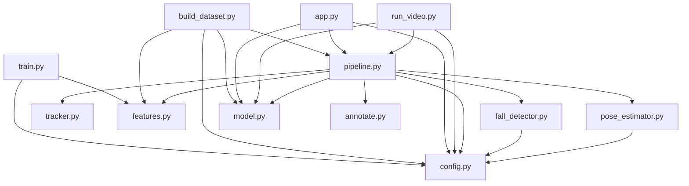
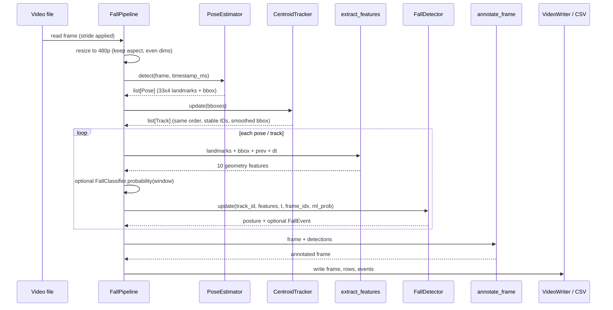
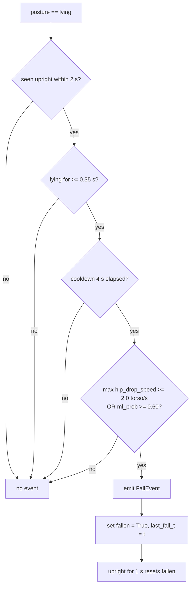

# Architecture — Fall Detection & Tracking

A CPU-only video pipeline that detects and tracks falls with **MediaPipe PoseLandmarker
(Tasks API, lite model)**. It is built for a low-end laptop: 480p frames, one pose by
default, no GPU, and no deep model beyond the 5.7 MB pose landmarker.

---

## 1. High-level design

The system is a **linear frame pipeline** with three independent concerns:

| Layer | Responsibility | Modules |
|---|---|---|
| Perception | Find people and their 33 keypoints | `pose_estimator.py` |
| Interpretation | Stable identity + geometry features + fall decision | `tracker.py`, `features.py`, `fall_detector.py`, `model.py` |
| Presentation / I/O | Video loop, annotation, exports, UI, training | `pipeline.py`, `annotate.py`, `run_video.py`, `app.py`, `build_dataset.py`, `train.py` |

Rules are the primary detector. The RandomForest (`model.py`) is an **optional second
opinion** that can confirm a fall when the rule threshold is not met.

---

## 2. Directory layout

```
fall_detection/
├── app.py                  # Streamlit demo (upload -> process -> results)
├── ARCHITECTURE.md
├── README.md
├── requirements.txt
├── models/
│   └── pose_landmarker_lite.task   # MediaPipe pose model (5.7 MB)
├── data/
│   ├── videos/             # input clips (user supplied)
│   ├── labels.csv          # optional ground truth: video,fall_start_s,fall_end_s
│   ├── labels.example.csv
│   ├── features/           # per-video feature cache (*.csv)
│   ├── windows.csv         # generated training windows
│   └── windows_meta.json   # window size + label source metadata
├── outputs/                # annotated MP4 + features/events CSV
├── src/
│   ├── config.py           # paths, frame size, thresholds
│   ├── pose_estimator.py   # MediaPipe wrapper
│   ├── tracker.py          # IoU / centroid tracker
│   ├── features.py         # geometric feature extraction
│   ├── fall_detector.py    # temporal rule state machine
│   ├── model.py            # window aggregation + RandomForest wrapper
│   ├── annotate.py         # skeleton / bbox / alert drawing
│   ├── pipeline.py         # orchestration of one video
│   ├── run_video.py        # CLI entry point
│   ├── build_dataset.py    # features -> windowed dataset
│   ├── train.py            # RandomForest training
│   └── download_model.py   # fetch the .task model
└── tests/
    └── test_logic.py       # 12 unit tests for pure logic
```

---

## 3. Module dependency graph



`pipeline.py` is the composition root: it is the only module that knows about
pose, tracking, features, detection and annotation at the same time. There are no
circular imports; `features.py`, `tracker.py`, `fall_detector.py`, `model.py` and
`annotate.py` are pure or stateful helpers that do not import `pipeline.py`.

---

## 4. Runtime data flow

### 4.1 One video (`FallPipeline.process_video`)



### 4.2 Ordering rules

1. **Resize first** — `target_size()` clamps height to `480` and width to `854`,
   preserving aspect ratio and rounding down to even dimensions (required by most
   video codecs).
2. **Timestamp** — `timestamp_s = frame_idx / src_fps`, where `frame_idx` is the
   source frame index. With `stride > 1`, time still advances correctly.
3. **Tracker continuity** — bboxes are matched by IoU first, then by centroid
   distance (≤ 0.8 × the larger bbox diagonal). This keeps the same ID through the
   large displacement of a real fall.
4. **Feature state** — `FallPipeline._prev[track_id]` stores the previous feature
   dict plus `t`, `cx`, `cy`; these feed `hip_drop_speed` and `center_speed`.
   `_buffers[track_id]` holds the last `classifier.window` feature dicts.
5. **Output** — annotated frames are written at `src_fps / stride`; rows are
   appended for every detection; events are appended when `FallEvent` is raised.

---

## 5. Core data structures

| Type | Module | Fields |
|---|---|---|
| `Pose` | `pose_estimator.py` | `landmarks (33×4)`, `bbox (4,)`, `score` |
| `Track` | `tracker.py` | `track_id`, `bbox`, `centroid`, `misses` |
| feature dict | `features.py` | 10 named floats, `NaN` when a joint is invisible |
| `Detection` | `pipeline.py` | `track_id`, `pose`, `features`, `posture`, `ml_prob`, `event`, `alert`, `trail` |
| `FrameResult` | `pipeline.py` | `frame_idx`, `timestamp_s`, `detections`, `annotated` |
| `VideoReport` | `pipeline.py` | source/output paths, size, fps, frame counts, duration, speed, `events`, `rows` |
| `FallEvent` | `fall_detector.py` | `track_id`, `frame_idx`, `timestamp_s`, `confidence`, `torso_angle`, `drop_speed`, `source` |
| `TrackState` | `fall_detector.py` | `history`, `posture`, `last_upright_t`, `lying_since`, `upright_since`, `fallen`, `last_fall_t` |

---

## 6. Features (`FEATURE_NAMES`)

All positional features are normalized by frame size or torso length so they are
independent of resolution and camera distance.

| Feature | Meaning | Used for |
|---|---|---|
| `torso_angle` | Shoulder–hip vector vs. vertical; 0° upright, 90° horizontal | posture classification |
| `torso_len` | Torso length / frame height | scale reference; validity check |
| `bbox_aspect` | Bbox width / height | shape cue (wide when lying) |
| `bbox_height` | Bbox height / frame height | proximity cue |
| `hip_y` | Hip midpoint y / frame height | vertical position |
| `shoulder_y` | Shoulder midpoint y / frame height | vertical position |
| `head_y` | Nose y / frame height | vertical position |
| `knee_angle` | Mean hip–knee–ankle angle | posture / ML only |
| `hip_drop_speed` | Downward hip motion in torso lengths per second | primary fall trigger |
| `center_speed` | Bbox-centre motion in torso lengths per second | ML only |

Landmark visibility below `0.4` marks a feature as `NaN`; the detector treats
non-finite values as `unknown` rather than guessing.

---

## 7. Fall decision logic

Posture is computed per frame from `torso_angle`:

- `angle ≤ 35°` → **upright**
- `angle ≥ 55°` → **lying**
- in between → **transition**
- invalid / short torso → **unknown**

A fall is emitted only when **all** of these hold:



- **Confidence** starts at `0.5`, adds up to `0.25` for drop speed, up to `0.25`
  for horizontal angle, and is blended 75/25 with `ml_prob` when available;
  clamped to `[0.5, 0.99]`.
- **Source** is `rules`, `ml`, or `rules+ml`.
- **Cooldown** suppresses duplicate events while the person stays down.
- **Recovery** requires one continuous second upright before a new fall can fire.

### Thresholds (`DetectorConfig`)

| Field | Default | Effect |
|---|---|---|
| `upright_angle` | 35° | Max torso angle still considered upright |
| `lying_angle` | 55° | Min torso angle considered lying |
| `fall_window_s` | 2.0 s | Max time from last upright to lying |
| `confirm_lying_s` | 0.35 s | How long lying must persist |
| `drop_speed` | 2.0 torso/s | Hip-speed threshold |
| `cooldown_s` | 4.0 s | Duplicate-event suppression |
| `recover_upright_s` | 1.0 s | Upright time to reset |
| `history_s` | 2.5 s | Feature history kept per track |
| `ml_threshold` | 0.60 | RandomForest confirmation threshold |

---

## 8. Optional ML path

```
labels.csv (or weak labels) + videos
        │
        ▼
build_dataset.py ── per video: FallPipeline(draw=False) ── feature cache
        │
        ▼
15-frame windows, step 5, ≥60% valid torso
        │
        ▼
aggregate_window(): mean/std/min/max of each feature (40 columns)
        │
        ▼
train.py: RandomForest(150 trees, depth 10, class_weight=balanced)
        │  grouped split by video when ≥3 videos, else stratified random
        ▼
models/fall_rf.joblib + fall_rf.metrics.json
        │
        ▼
FallClassifier.load() → probability() → FallDetector(ml_prob=…)
```

The artifact stores `model`, `feature_names`, `base_features`, `window`,
`threshold`, `metrics`, and `trained_at`. At runtime only the last `window`
frames are used; `probability()` returns `None` until the buffer is full, so the
ML path never fires on a cold start.

---

## 9. Entry points

| Entry point | Command | Purpose |
|---|---|---|
| CLI | `python -m src.run_video --input clip.mp4 --show` | Process one file, write MP4 + CSVs |
| Streamlit | `streamlit run app.py` | Upload, tune thresholds, view events/key frames/signals |
| Dataset | `python -m src.build_dataset` | Build `data/windows.csv` from `data/videos` |
| Train | `python -m src.train` | Fit and save the RandomForest |
| Model download | `python -m src.download_model` | Fetch `pose_landmarker_lite.task` |

CLI overrides: `--lying-angle`, `--drop-speed`, `--confirm`, `--stride`,
`--num-poses`, `--classifier`, `--no-output`, `--no-csv`, `--csv`, `--events`.

---

## 10. Output artifacts

**Annotated video** — H.264 (`avc1`) when the OpenCV build supports it, `mp4v`
otherwise; FPS = `source_fps / stride`.

**Features CSV** (`FEATURE_ROW_COLUMNS`, always has a header):

```
frame_idx, timestamp_s, track_id, posture, ml_prob, event,
torso_angle, torso_len, bbox_aspect, bbox_height, hip_y,
shoulder_y, head_y, knee_angle, hip_drop_speed, center_speed
```

**Events CSV** — `track_id, frame_idx, timestamp_s, confidence, torso_angle,
drop_speed, source`.

**Training data** — `windows.csv` (`video`, `track_id`, `t_start`, `t_end`,
`label`, 40 aggregated features) and `windows_meta.json`.

---

## 11. Design decisions

- **Rules before ML.** The detector must work on day one with no training data;
  the classifier only adds a confirmation path.
- **Scale-invariant features.** Everything positional is divided by frame height
  or torso length, so thresholds transfer between clips and camera distances.
- **Lite model + 480p.** Keeps CPU inference practical on an i5-4200U; `stride`
  is the escape hatch for slower machines.
- **Stable IDs under fast motion.** IoU alone loses a falling person; the centroid
  fallback preserves identity through the drop.
- **No dependency on `mp.solutions`.** Uses `mediapipe.tasks.python.vision`
  (PoseLandmarker, VIDEO mode) as required.
- **Single composition root.** Only `pipeline.py` wires perception to
  interpretation, which keeps every helper unit-testable.

---

## 12. Known limitations

- One camera view; no 3D or ground-plane calibration.
- Occlusion or an incomplete body can yield `unknown` posture and no event.
- A person who deliberately lies down slowly is correctly **not** flagged
  (the hip-drop rule requires speed); a very slow genuine fall may be missed.
- The RandomForest is only as good as the labelled clips; without `labels.csv`
  it trains on rule-based weak labels.
- `data/videos/` is empty in the repository, so no demo outputs ship with it.
